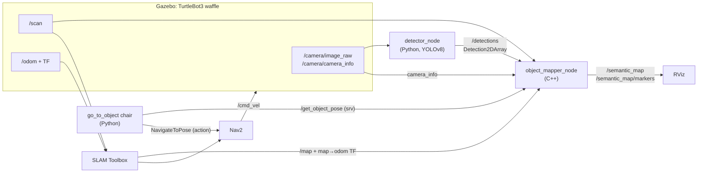

# ros2-semantic-nav

> "TurtleBot, go to the chair."
> A ROS 2 robot that **sees objects with YOLOv8, places them on its map, and navigates to them with Nav2**.


<!-- TODO(M7): replace this line with a GIF of the robot driving to an object -->

## Goal

Classic navigation answers *"go to (x, y)"*. Semantic navigation answers *"go to the chair"*.
This project builds the missing link in simulation (Gazebo + TurtleBot3 waffle):

1. **Detect** objects in the camera image (YOLOv8).
2. **Localise** each detection in 3D by fusing the camera bearing with the 2D LiDAR range and TF.
3. **Map** objects over time (data association + fusion) into a *semantic map*.
4. **Navigate** to a requested object with Nav2, stopping in front of it.

## Architecture



| Package | Language | Role |
|---|---|---|
| `semantic_nav_interfaces` | msg/srv | `SemanticObject`, `SemanticObjectArray`, `GetObjectPose` |
| `semantic_nav_detector` | Python | YOLOv8 inference, publishes `vision_msgs/Detection2DArray` |
| `semantic_nav_mapper` | **C++** | camera bearing + LiDAR range + TF → objects in the `map` frame, association, fusion, goal service |
| `semantic_nav_commander` | Python | Mission node: asks the mapper, sends the goal to Nav2, explores if needed |
| `semantic_nav_bringup` | launch | Gazebo + SLAM + Nav2 + RViz + perception, configs |

**Why LiDAR + camera instead of a depth camera?** The TurtleBot3 waffle has a monocular RGB camera and a 2D LiDAR.
The box centre gives a *direction* (pinhole model), the LiDAR gives the *distance* in that direction.
This is a cheap and robust sensor fusion, and it is the core algorithm of the project.

## Quick start

```bash
git clone https://github.com/AkramSakly/ros2-semantic-nav.git
cd ros2-semantic-nav
docker build -t semantic-nav -f docker/Dockerfile .

xhost +local:docker
docker run -it --rm --net=host -e DISPLAY=$DISPLAY \
    -v /tmp/.X11-unix:/tmp/.X11-unix -v $(pwd)/src:/ws/src semantic-nav

# inside the container
ros2 launch semantic_nav_bringup sim.launch.py
# second terminal (docker exec -it <id> bash)
ros2 run semantic_nav_commander go_to_object chair
```

Without Docker (Ubuntu 22.04 + ROS 2 Humble): install the apt packages listed in `docker/Dockerfile`,
then `colcon build --symlink-install` in a workspace that contains `src/`.

Tests: `colcon test && colcon test-result --verbose`

## Roadmap

Each milestone has a GitHub issue with the tasks and hints. Look for `TODO(Mx)` in the code.

- [ ] **M0: Setup.** ([#1](https://github.com/AkramSakly/ros2-semantic-nav/issues/1)) Docker image builds, GitHub Actions CI runs `colcon build` + `colcon test`.
- [ ] **M1: Simulation and navigation.** ([#2](https://github.com/AkramSakly/ros2-semantic-nav/issues/2)) Gazebo + SLAM Toolbox + Nav2 run; custom world with objects YOLO can recognise; map saved.
- [ ] **M2: Object detection.** ([#3](https://github.com/AkramSakly/ros2-semantic-nav/issues/3)) `detector_node` publishes YOLOv8 detections and an annotated image.
- [ ] **M3: Detection → map projection (C++).** ([#4](https://github.com/AkramSakly/ros2-semantic-nav/issues/4)) Pixel bearing + LiDAR range + TF gives the object position in `map`. Unit tested.
- [ ] **M4: Semantic map.** ([#5](https://github.com/AkramSakly/ros2-semantic-nav/issues/5)) Data association, fusion, false-positive filtering, RViz markers.
- [ ] **M5: Go to object.** ([#6](https://github.com/AkramSakly/ros2-semantic-nav/issues/6)) `/get_object_pose` computes a goal in front of the object; the commander drives there with Nav2.
- [ ] **M6: Exploration and speed (stretch).** ([#7](https://github.com/AkramSakly/ros2-semantic-nav/issues/7)) Explore when the object is unknown; ONNX Runtime inference and FPS comparison.
- [ ] **M7: Evaluation and demo.** ([#8](https://github.com/AkramSakly/ros2-semantic-nav/issues/8)) Object position error vs Gazebo ground truth, navigation success rate, demo GIF/video.

## Results

<!-- TODO(M7): fill this table with your measurements -->

| Metric | Value |
|---|---|
| Detector FPS (PyTorch CPU / ONNX CPU) | – / – |
| Mean object position error (m) | – |
| Go-to-object success rate (N trials) | – |

## Author

**Akram Sakly**: robotics and computer vision engineering student.
Related work: [TurtleBot3 lane follower (U-Net, ONNX)](https://github.com/AkramSakly/turtlebot3-autorace-lane-follower) · [Stereo VIO](https://github.com/AkramSakly/Stereo-VIO-Project)

## Acknowledgements

Built on [ROS 2](https://docs.ros.org/en/humble/), [Nav2](https://navigation.ros.org/), [SLAM Toolbox](https://github.com/SteveMacenski/slam_toolbox),
[TurtleBot3 simulations](https://github.com/ROBOTIS-GIT/turtlebot3_simulations) (ROBOTIS) and [Ultralytics YOLOv8](https://github.com/ultralytics/ultralytics).

## License

MIT
